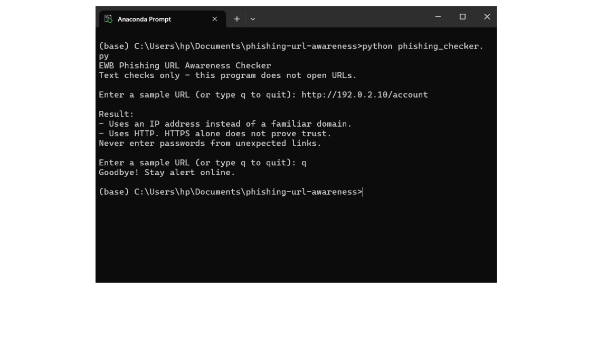
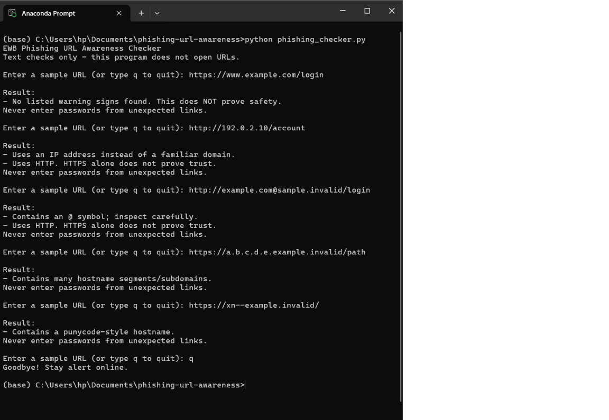

# Phishing URL Awareness Checker

## Overview
Phishing is a trick where criminals send fake links or messages to make people share passwords, card numbers or OTPs. This project is a small Python command-line tool that reads the text of a URL and points out six visible warning signs, such as an @ symbol, an IP-address hostname or a plain HTTP connection. It only reads the URL text and never opens the link, and "no warnings found" does not mean a link is safe.

## Features
- Detects an @ symbol in the URL
- Flags unusually long URLs (over 100 characters)
- Flags IP-address hostnames
- Flags many hostname segments (5 or more)
- Flags punycode-style hostnames (xn--)
- Flags the HTTP scheme
- Loop mode: check several URLs without restarting, type q to quit
- Handles malformed input (for example http://[bad) without crashing

## Requirements
Python 3.10 or later. No extra packages.

## How to Run
Windows: python phishing_checker.py
Mac/Linux: python3 phishing_checker.py

## Example Output
EWB Phishing URL Awareness Checker
Text checks only - this program does not open URLs.

Enter a sample URL (or type q to quit): http://192.0.2.10/account

Result:
- Uses an IP address instead of a familiar domain.
- Uses HTTP. HTTPS alone does not prove trust.
Never enter passwords from unexpected links.

Enter a sample URL (or type q to quit): q
Goodbye! Stay alert online.

## Testing
| # | Input | Expected | Actual | Result |
|---|-------|----------|--------|--------|
| 1 | https://www.example.com/login | No warning signs | No listed warning signs found | PASS |
| 2 | http://192.0.2.10/account | IP address + HTTP | IP address warning + HTTP warning | PASS |
| 3 | http://example.com@sample.invalid/login | @ symbol + HTTP | @ symbol warning + HTTP warning | PASS |
| 4 | https://a.b.c.d.e.example.invalid/path | Many hostname segments | Many hostname segments warning | PASS |
| 5 | https://xn--example.invalid/ | Punycode-style hostname | Punycode-style hostname warning | PASS |

Full table: tests/test_samples.md

## Screenshots

## Improvements
1. Loop with quit - Earlier, the program asked for one URL and then closed, so I had to restart it for every test. I changed main() to use a while True loop, so it keeps asking for URLs until I type q, quit or exit. I chose this because it makes testing faster and is easy to explain. I tested it by entering all five sample URLs in one session and then typing q, and the program exited with a goodbye message.

2. Malformed input handling - Earlier, typing http://[bad made Python raise a ValueError and the program crashed. I wrapped the urlparse line in a try/except block, so the program now shows "This text is not a valid URL format." and keeps running. I chose this because a security tool should not crash on strange input. I tested it by typing http://[bad, which showed the friendly message, and then re-ran all five sample URLs to make sure they still gave the same results.

## Limitations
This is an educational tool. It only reads URL text. It does not visit
URLs, scan for malware or prove that a URL is safe. No warning signs
found does NOT mean a URL is safe.

## Ethical Use
Use sample strings only. Do not collect credentials. Do not use this
project to deceive anyone or to test websites without permission.

## Author
Neha Sreejay, AI Powered Cybersecurity Internship, EWB Courses
